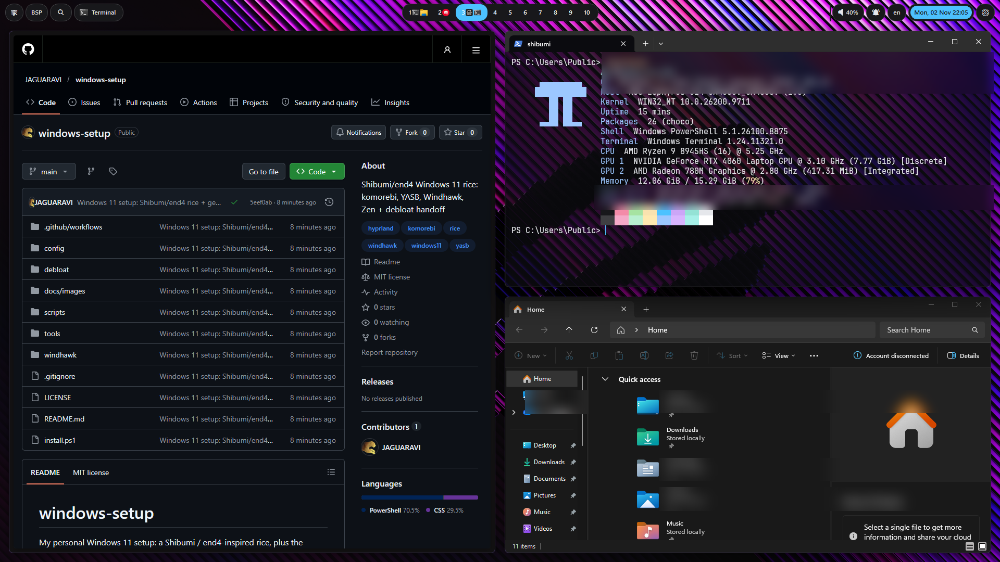
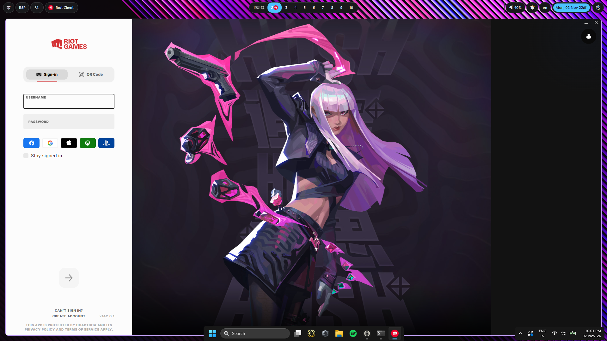

# windows-setup

My personal Windows 11 setup: a Shibumi / end4-inspired rice, plus the
debloat handoff and scripts from this machine.

## Quick start

Run in an **Administrator** PowerShell:

```powershell
git clone https://github.com/JAGUARAVI/windows-setup.git
cd windows-setup
Set-ExecutionPolicy -Scope Process Bypass
.\install.ps1
```

Optional:

```powershell
.\install.ps1 -Debloat          # also apply the debloat scripts (read debloat/HANDOFF.md first)
.\install.ps1 -SkipWindhawk    # skip Windhawk and the taskbar mods
```

The installer backs up files it replaces with `*.bak-<timestamp>`.

The published komorebi config has empty `ignore_rules` and
`transparency_ignore_rules`; add the game/anti-cheat executables you want
komorebi to leave alone. Terminal profiles are Windows-only by default; add
your own WSL distributions if you use them.

## What's inside

| Piece | What it does |
| --- | --- |
| **komorebi + whkd + masir** | Tiling, gaps, 10 workspaces per monitor, animations, hover focus |
| **YASB 2.0.7 + Shibumi theme** | One top bar on both displays; 10 centered workspaces with app icons, clock on the right |
| **Windhawk 2.0 + Taskbar Styler (DockLike)** | Floating bottom dock |
| **Native Windows taskbar auto-hide** | Dock hides while working; hover the bottom edge to reveal |
| **Windows Terminal (Shibumi profile)** | Translucent 78/68%, JetBrainsMono NF, OMP prompt, Shibumi colors |
| **Flow Launcher** | Win+Space / Alt+Space launcher, BlurBlack theme |
| **Oh My Posh + fastfetch** | Prompt and `ff` system card |
| **Zen Browser** | Win+W; default browser when Windows permits |

## Screenshots






## Shortcuts — end4 / Super style

### Apps
| Keys | Action |
| --- | --- |
| `Win + Return` / `Win + T` | Terminal |
| `Win + E` | File Explorer |
| `Win + W` | Zen Browser |
| `Win + C` | VS Code |
| `Win + Space` / `Alt + Space` | Flow Launcher |

### Window
| Keys | Action |
| --- | --- |
| `Win + Q` | Close |
| `Win + D` | Maximize (fill work area) |
| `Win + Shift + D` | Monocle (fill tiling workspace, gaps stay) |
| `Win + F` | Fullscreen (sends F11) |
| `Win + Alt + Space` | Toggle floating |
| `Win + P` | Pin / lock |
| `Win + Shift + Return` | Promote |
| `Win + Alt + X` / `Y` | Flip layout horizontal / vertical |

### Focus / workspaces
| Keys | Action |
| --- | --- |
| `Win + Arrows` | Focus left / right / up / down |
| `Win + Shift + Arrows` | Move window |
| `Win + Ctrl + Left` / `Right` | Previous / next workspace |
| `Win + Ctrl + Alt + Left` / `Right` | Previous / next monitor |
| `Win + Ctrl + Alt + Shift + Left` / `Right` | Move window to previous / next monitor |
| `Win + 1..9, 0` | Workspace 1–10 |
| `Win + Alt + 1..9, 0` | Move window to workspace 1–10 |
| `Win + +` / `-` | Resize wider / narrower (`Shift` = vertical) |

### Bar / rice
| Keys | Action |
| --- | --- |
| `Win + J` | Hide / show top bar |
| `Win + /` | Shortcut cheatsheet |
| `Win + Alt + P` | Pause tiling |
| `Win + Alt + R` | Retile |
| `Win + Alt + O` | Reload whkd |
| `Win + Shift + N` / `B` / `P` / `M` | Next / previous / play-pause / mute |

Native shortcuts kept: `Win+V`, `Win+Period`, `Win+I`, `Win+L`, `Win+Tab`,
`Win+Shift+S`, `Win+N`, `Win+A`, `Win+X`, `Win+G`, `Ctrl+Shift+Esc`.

## Bar behavior

- One YASB bar (`screens: ['*']`) spans both displays.
- Workspaces are the **center** group; clock/date is on the **right**.
- **White workspace numbers**; populated workspaces show up to 2 app icons.
- Wallpaper gallery and systray widgets removed from the bar.
- Trimmed padding: 6 px top / 8 px sides.
- **Hover focus**: masir runs with komorebi; the tile under the mouse becomes focused.
- **Bottom dock**: native auto-hide — hidden while working, bottom-edge hover reveals it.
- No hardcoded monitor order or Qt scaling override; Windows primary stays automatic.

## Zen Browser / default browser

`Win + W` launches Zen. Windows 11 24H2+ ships the **UCPD driver**, which
blocks scripted changes to the `UserChoice` association keys, even as admin.
The native way is:

1. Open `ms-settings:defaultapps?registeredAppUser=Firefox-F0DC299D809B9700`
   (or Settings → Apps → Default apps → Zen Browser).
2. Click **Set default** once.

`scripts/set-default-browser.ps1` finds the right registration and opens that
page. `tools/SFTA.ps1` is included for older builds where UCPD is absent.

## Debloat (optional, recommended)

Windows 11 ships with telemetry, consumer apps, background tasks, and
suggestions that are not needed for the rice. This pass trims that down. It is
independent of the desktop setup: you can install the rice without it, or
apply it later.

Why do it: fewer background services/tasks, less telemetry and ad surface,
lower idle overhead, and more disk. It is not a security silver bullet and it
is not required for komorebi/YASB.

### What it changes

| Area | What was changed |
| --- | --- |
| Copilot / AI | Removed Copilot; disabled Recall, Click to Do, Windows AI data analysis, Paint Cocreator/Generative Fill/Image Creator; `WSAIFabricSvc` set to Manual/Stopped |
| Consumer apps | Removed selected inbox/consumer apps (news, weather, tips, solitaire, maps, media, Clipchamp, feedback, Dev Home, Quick Assist, classic Teams, Edge extras, etc.) |
| Telemetry services | DiagTrack, dmwappushservice, WerSvc, InventorySvc, MapsBroker, RetailDemo, RemoteRegistry, Fax (if present) |
| Telemetry tasks | Compatibility Appraiser, Feedback Siuf (`DmClient`, `DmClientOnScenarioDownload`), WER QueueReporting, CEIP Consolidator/USB CEIP, Disk Diagnostic Data Collector |
| Privacy / policies | Telemetry 0, no feedback prompts, no advertising ID, no tailored experiences, no consumer/Spotlight suggestions, no web/Bing search, Office telemetry off, Edge sidebar/rewards/background off |
| Startup | Optional cleanup of game launchers, media apps, VPN clients, and OEM trialware; add your own names in the script |
| Task Manager | Removed the `DisableTaskMgr` policy that blocked it |
| Disk | Safe cache cleanup (Windows Update, Temp, Delivery Optimization, GPU shader caches, old logs, Recycle Bin) |
| Updates / drivers | Windows Update cache reset and current cumulative/.NET/driver updates; an offered BIOS update can be hidden from automatic install |

The scripts are the source of truth for the exact package, service, task, and
registry lists. See [`debloat/HANDOFF.md`](debloat/HANDOFF.md) for the generic
handoff and [`debloat/`](debloat/) for the scripts.

### What it leaves alone

- Game clients and anti-cheat, WSL, personal files.
- Windows Search, SysMain, Spooler, BITS, Xbox/Gaming services.
- Defender/security services, VPNs, OEM control software and drivers.
- The BIOS is not flashed; an offered BIOS update is only hidden.
- Store, Terminal, core inbox apps, browser/WebView2, Office, dev tools,
  WSL, and OEM drivers.

### Run it

`install.ps1 -Debloat` runs `04-debloat.ps1`, `08-privacy-extra.ps1`,
`10-ai-safe-tweaks.ps1`, then `06-verify.ps1`. It does **not** run backups or
disk cleanup.

For the full sequence:

```powershell
cd debloat
.\03-backup.ps1          # registry/app/service/task backups first
.\04-debloat.ps1         # Copilot/appx/services/tasks/startup
.\08-privacy-extra.ps1   # extra privacy policies
.\10-ai-safe-tweaks.ps1  # WSAIFabricSvc + Recall/Copilot/Paint policies
.\06-verify.ps1
```

Optional: `02-cleanup.ps1` (safe caches/temp); review the paths first.
Rollback: `07-rollback.ps1`.

### Safety

- Read `HANDOFF.md` before running.
- No System Restore point was available on the original setup. Make a
  restore point or VM snapshot first; `03-backup.ps1` exports the registry,
  services, tasks, startup, and app lists, but is not a full disk backup.
- Some scripts contain paths/comments from the original setup; review before
  applying to different hardware.
- Feature updates can re-enable AI services or policies. Recheck
  `WSAIFabricSvc`, Recall/Copilot policies, and widgets after major updates.
- Do not stack other debloat tools on top; they conflict.

The debloat can free several GB depending on caches and installed apps; treat
that as a range, not a guarantee.

## Autostart

- **komorebi + whkd + masir** — scheduled task `komorebi-shibumi` (15 s delay, hidden)
- **YASB** — `yasbc enable-autostart`
- **Flow Launcher** — Flow's `StartFlowLauncherOnSystemStartup`
- **Windhawk** — service, automatic
- **Windows Terminal** — default console

## Rollback

1. Remove autostart:
   ```powershell
   schtasks /Delete /TN "komorebi-shibumi" /F
   & "C:\Program Files\YASB\yasbc.exe" disable-autostart
   ```
2. Restore replaced files from their `*.bak-*` copies.
3. Remove Windhawk mods:
   ```powershell
   windhawk-cli mod remove windows-11-taskbar-styler --yes
   ```
4. Uninstall the stack:
   ```powershell
   winget uninstall LGUG2Z.komorebi LGUG2Z.whkd LGUG2Z.masir AmN.yasb Flow-Launcher.Flow-Launcher
   winget uninstall RamenSoftware.Windhawk DEVCOM.JetBrainsMonoNerdFont Fastfetch-cli.Fastfetch
   ```
5. Debloat rollback: `debloat\07-rollback.ps1`.

## Repo layout

```
config/        komorebi, whkd, YASB, Terminal, OMP, fastfetch, Flow, PowerShell
scripts/       f11 + media helpers, komorebi starter, Zen default
windhawk/      Taskbar Styler settings
debloat/       HANDOFF.md and the original debloat scripts
tools/         PS-SFTA (MIT) for older Windows builds
install.ps1    installer
```

## Repository

Public repo: <https://github.com/JAGUARAVI/windows-setup>

## Credits

- Inspired by [end-4/dots-hyprland](https://github.com/end-4/dots-hyprland).
- YASB theme: **Shibumi** (YASB themes gallery).
- [komorebi](https://github.com/LGUG2Z/komorebi), [masir](https://github.com/LGUG2Z/masir), [whkd](https://github.com/LGUG2Z/whkd).
- Taskbar mods: [m417z](https://github.com/m417z) / [Windhawk](https://windhawk.net).
- `tools/SFTA.ps1`: [DanysysTeam/PS-SFTA](https://github.com/DanysysTeam/PS-SFTA), MIT.

No credentials or API tokens are committed. The Flow proxy credentials are
blank; add your own locally if needed.
